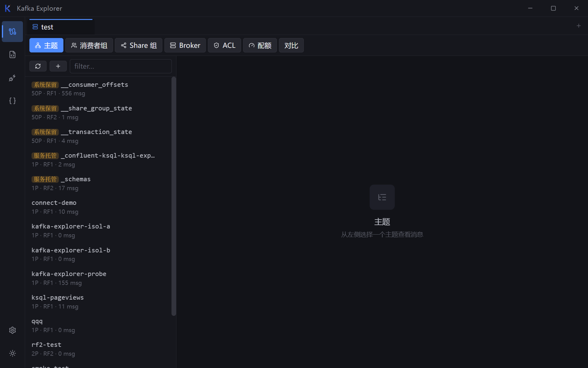
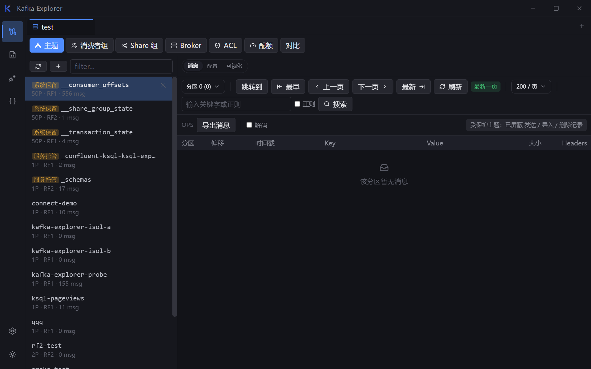
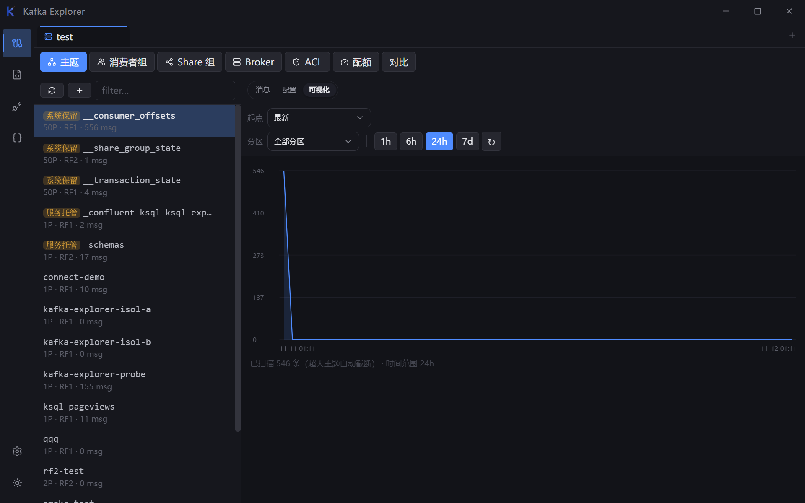
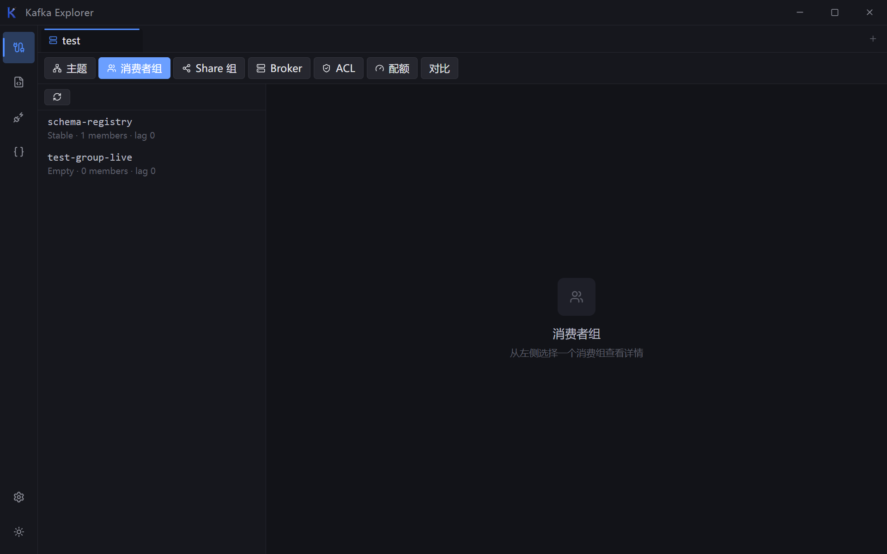

<div align="center">


# Kafka Explorer

**一款 Kafka 集群可视化管理桌面应用 · A visual desktop client for Apache Kafka clusters**


[下载安装包](../../releases/latest) · [问题反馈](../../issues)

</div>



## 项目简介

Kafka Explorer 是一款本地优先的 Kafka 集群可视化管理工具：连接集群后即可浏览主题与消息、管理消费者组与 Offset、操作 Schema Registry / Kafka Connect / ksqlDB，全程无需命令行。数据只在你的电脑与 Kafka 集群之间流转——应用不内置任何遥测，连接密码由 Windows 凭据管理器保管，本地数据库不存任何秘密。

## 核心能力

- 🔌 **集群连接** — PLAINTEXT / SASL / SSL / mTLS，连接级多标签页，健康探活红绿点。
- 📋 **主题与消息** — 主题增删改查、配置查看与编辑；消息浏览/搜索（关键字与正则）/发送/导出（JSONL、CSV），Key/Value 自动识别编码（Avro、JSON、文本、十六进制兜底）。
- 👥 **消费者组** — 组列表、成员与 Lag 明细、Offset 重置（DryRun 预览先行）、分区级 Offset 编辑、Share 组（Kafka 4.x 队列协议）。
- 🏗️ **Schema Registry** — 注册中心管理、主题版本历史、兼容性检查工作台、双版本 Diff、本地 Schema 离线解码。
- 🔗 **Kafka Connect** — 集群与连接器全生命周期管理（创建/暂停/恢复/重启/删除），任务状态与错误追踪。
- 🧮 **ksqlDB** — 服务管理、交互式查询编辑器、流/表/查询浏览。
- 🛡️ **运维面** — Broker 列表与动态配置、ACL 管理、配额管理、Quorum 查看、集群对比。
- 📊 **可视化** — 消息速率直方图，四种起点（最新/最早/按时间/按 Offset），分区级筛选。
- 🎨 **体验** — 暗色/亮色主题、中英双语、界面字号与中西文字体分开调节、系统托盘驻留、配置一键备份/恢复、应用内自动更新。

## 产品界面

| | |
| --- | --- |
|  **消息浏览** |  **消息速率可视化** |
|  **消费者组** |  **主题列表** |

## 安装

### 下载安装包

| 平台 | 架构 | 形式 | 下载 |
| --- | --- | --- | --- |
| Windows | x64 | 安装版 | [Releases](../../releases/latest) |

> 需要 Windows 10 或更高版本；缺失 WebView2 运行时时安装器会自动下载安装。

安装器为单文件，双击即可：选择安装目录（自动避开盘符根目录）、可选是否安装后启动。卸载时可选是否同时删除用户数据。

### 自动更新

应用内置更新检查：设置页可配置更新源（GitHub `owner/repo`），或使用发布构建的默认源。发现新版本后可在应用内直接下载（带进度）并静默升级，无需重新下载安装包。

## 本地开发

依赖：Go 1.27+、Node.js 22+、[Wails v3 CLI](https://v3.wails.io)（alpha2.117）。

```bash
go install github.com/wailsapp/wails/v3/cmd/wails3@v3.0.0-alpha2.117
wails3 task dev        # 开发模式
wails3 task precommit  # 完整门禁：生成绑定 → 审计 → 前端构建 → Go 构建 → 测试
```

发布构建（产出单文件安装器）：

```bash
wails3 task installer RELEASE_REPO=your-github/kafka-explorer
```

`RELEASE_REPO` 会作为应用内自动更新的默认源打进构建产物；不加该参数时更新检查默认关闭，用户可在设置中自行填写。

## 免责声明

- 本项目与 Apache Software Foundation 无关。Apache Kafka 是 Apache Software Foundation 的商标。
- 请仅在获得授权的前提下连接和管理 Kafka 集群，因使用本工具产生的账号、数据与合规责任由使用者自行承担。

## 协作

- 欢迎通过 [Issues](../../issues) 反馈问题与建议。
- 仓库采用 [Apache-2.0](LICENSE) 许可证。

## 感谢

本项目基于 [Go](https://go.dev)、[Wails](https://wails.io)、[React](https://react.dev) 与 [SQLite](https://sqlite.org) 等开源项目构建，完整依赖清单见 [go.mod](go.mod) 与 [package.json](frontend/package.json)。
